<!--
  Calvin SZE · Software Engineer · NYC
  GitHub profile README — dynamic edition
-->

<!-- ============ HEADER ============ -->

<!-- 自托管 banner：把 header.svg 放到仓库根目录即可，不依赖任何第三方服务 -->

 

<!-- ============ SOCIAL BADGES ============ -->

<!-- TODO: 把下面的 # 换成你的 LinkedIn 主页链接 -->

  

---

<!-- ============ ABOUT ============ -->
<h3 align="center">👋 About</h3>

Software engineer based in <b>New York City</b>, focused on building systems that are 
<b>distributed</b>, <b>low-latency</b>, and <b>resilient</b> — from the API surface down to the infrastructure. 
I like turning hard backend problems into simple, reliable interfaces, and I'm comfortable 
going full-stack when a project needs it.

🔭 &nbsp;Building &amp; shipping systems, APIs, and infra &nbsp;•&nbsp;
🌱 &nbsp;Always leveling up on distributed systems &nbsp;•&nbsp;
💬 &nbsp;Ask me about backend, infra, or low-latency design

---

<!-- ============ TECH STACK ============ -->
<h3 align="center">🛠️ Tech Stack</h3>

<b>Languages</b>

  
  
  
  
  
  

<b>Backend &amp; Systems</b>

  
  
  
  
  
  

<b>Frontend &amp; Full-stack</b>

  
  
  
  

<b>Data &amp; ML</b>

  
  
  
  

<b>Cloud &amp; Infrastructure</b>

  
  
  
  
  
  

---

<!-- ============ CURRENTLY BUILDING (self-hosted, 永不裂图) ============ -->

  

<!--
  ┌───────────────────────────────────────────────────────────────────────┐
  │  实时 GitHub Stats 卡（暂时注释掉）                                       │
  │                                                                         │
  │  这些卡依赖公共第三方服务，有两个已知问题：                                 │
  │   1. github-readme-stats / trophy 的公共实例经常被限流 → 会裂图            │
  │   2. 你的 profile 目前是私密的，贡献活动不公开 → 数字会显示 0              │
  │                                                                         │
  │  等你把 profile 改成公开、且有公开贡献后，删掉这段注释符即可启用：          │
  │  （建议同时把 github-readme-stats 自建到你自己的 Vercel 实例以彻底免限流）  │
  └───────────────────────────────────────────────────────────────────────┘

<h3 align="center">📊 GitHub Stats</h3>

  

  

-->

---

<!-- ============ FOOTER ============ -->

  
  📫 <a href="mailto:hey@calvinsze.com">hey@calvinsze.com</a> &nbsp;·&nbsp; 🌐 <a href="https://www.calvinsze.com">calvinsze.com</a> &nbsp;·&nbsp; 🐙 <a href="https://github.com/calvinsyy">github/calvinsyy</a>

